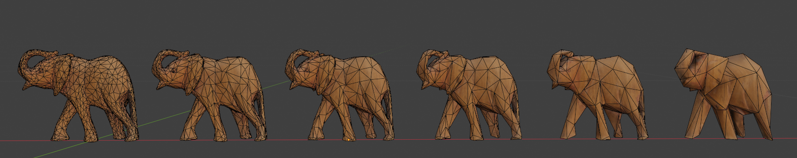
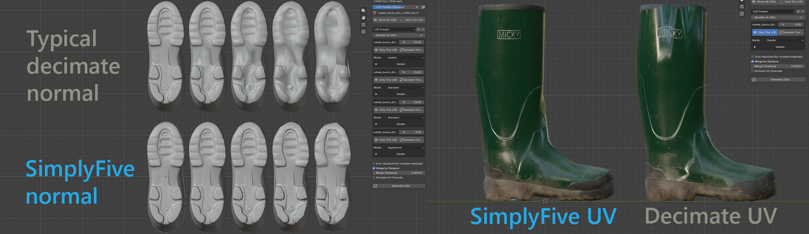

# SimplyFive Light

**Fewer triangles, ready-to-use LODs.** A free Blender add-on that creates up to five simplified versions of a mesh in one pass. Set a triangle budget for each level, choose how aggressively to simplify, and compare the results in the viewport.

[Download Light](https://github.com/zloy-pingvin/SimplyFive-Light/releases/latest) · [Website](https://zloy-pingvin.github.io/SimplyFive-Light/) · [Manual](https://zloy-pingvin.github.io/SimplyFive-Light/docs.html) · [Русский](README.ru.md)

## What it does

| Feature | What you get |
| --- | --- |
| Up to five LODs | Set each target as a percentage of the source or an absolute triangle count. |
| Five quality modes | Choose from Careful through Very Aggressive, independently for each level. |
| UVs, normals, and materials | Simplification takes surface attributes into account, with support for multiple UV maps and materials. |
| Importance maps | Use vertex colors or a vertex group to keep more detail where it matters. |
| Viewport comparison | Switch between levels with LOD Preview, or place them side by side with Line Up LODs. |
| Result reports | See the actual triangle count and hints when a mesh cannot reach its target. |

Light also carries vertex colors onto the result, preserves parent relationships between generated levels, and can reorder mesh data for GPU efficiency. The interface is available in English and Russian.

*A simplification example from the website. Results depend on the mesh and settings.*

## Install

Requires **Blender 4.2 or newer**. The simplification library is bundled; no separate build is needed.

1. Download the **SimplyFive Light ZIP** from [Releases](https://github.com/zloy-pingvin/SimplyFive-Light/releases/latest). Choose the add-on archive, not GitHub's source-code ZIP.
2. In Blender, open **Edit → Preferences → Add-ons**.
3. Open the menu at the top right, choose **Install from Disk…**, and select the ZIP.
4. Enable **SimplyFive Light**.

## Make your first LODs

1. Select a mesh in the viewport.
2. Press **N** to open the sidebar, then choose the **LODS** tab.
3. Set **Number of LODs**. Start with three levels.
4. Give each level a target using **%** or **Tris**, then choose its quality mode. Try gentler modes for nearby LODs and more aggressive ones for distant LODs.
5. Click **Generate LODs**.

The source becomes `name_lod_0`; the simplified objects are named `name_lod_1`, `name_lod_2`, and so on. Enable **Keep the original object** to generate from a copy instead: the original keeps its name and is hidden. The `_lod_` suffix is configurable in Preferences.

Use **LOD Preview (distance)** to inspect individual levels, or **Line Up LODs** to compare them side by side. Check the result under each level before exporting.

## Before you simplify

- A triangle target is a goal. Seams, protected details, and the selected mode can keep the result above it; the result report explains what happened.
- Light generates geometry from the current pose and shape-key mix. It does not transfer the rig or shape keys to the LODs.
- Source checks can flag UV and duplicate-surface problems before generation.
- The optional daily update check can be disabled in Preferences.

For settings and troubleshooting, see the [manual](https://zloy-pingvin.github.io/SimplyFive-Light/docs.html).

## Need more control?

Light works on its own and is free. **SimplyFive Pro** adds detailed per-level settings, batch processing, chained LODs, and transfer options for vertex groups and shape keys. See the [website](https://zloy-pingvin.github.io/SimplyFive-Light/) for the full comparison.

## Author and license

By **zloy_pingvin**.

SimplyFive Light is licensed under [GPL-3.0-or-later](LICENSE). It uses [meshoptimizer](https://github.com/zeux/meshoptimizer) by Arseny Kapoulkine, licensed under MIT; see [third-party notices](THIRD-PARTY-NOTICES.txt).
